# B3-1 · 서울 리전의 웹페이지를 인터넷에 배포하기

AWS 서울 리전(`ap-northeast-2`)에 격리된 VPC와 퍼블릭 서브넷을 만들고, EC2에서 Nginx로 간단한 웹페이지를 제공했다. 실습 계정은 과제용 IAM 사용자 `codyssey-b3-1`이며 루트 계정으로 인프라를 만들지 않았다. HTTPS와 Docker 보너스 과제는 수행하지 않았다.

> **실습 종료 안내:** 아래 공인 IP와 URL은 실습 당시의 접속 정보다. EC2와 네트워크 자원, 과제용 IAM 사용자·정책을 삭제했으므로 현재 이 과제 페이지에 접속할 수 없다. 삭제 근거는 [정리 체크리스트](docs/cleanup-checklist.md)에 기록했다.

## 아키텍처와 구성 요소

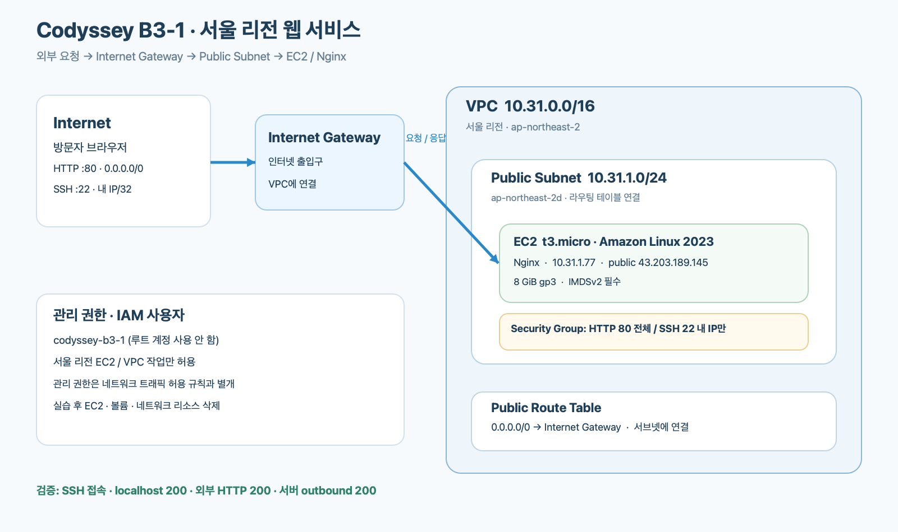

방문자의 HTTP 요청은 공인 IP → Internet Gateway → 퍼블릭 서브넷의 EC2 → Nginx 순서로 도착한다. 서브넷에 연결된 라우팅 테이블의 `0.0.0.0/0 → Internet Gateway` 경로가 서버의 외부 통신도 가능하게 한다. 보안 그룹은 EC2에 도착하는 포트를 제어하고, IAM 정책은 AWS 리소스를 관리할 수 있는 API 권한을 제어한다.

| 구성 요소 | 주요 설정 | 역할 |
| --- | --- | --- |
| VPC | `10.31.0.0/16` | 실습 전용 네트워크 경계 |
| Public Subnet | `10.31.1.0/24`, 서울 `2d` | EC2 배치. 인스턴스 시작 시 공인 IP를 개별 할당 |
| Internet Gateway | VPC에 연결 | VPC와 인터넷 연결 |
| Route Table | 서브넷에 명시적으로 연결, `0.0.0.0/0 → Internet Gateway` | 인터넷으로 향하는 기본 경로 |
| Security Group | HTTP `80/tcp`: `0.0.0.0/0` · SSH `22/tcp`: 실습자 IP `/32` | 필요한 포트만 허용. 전체 포트 개방 없음 |
| EC2 / EBS | Amazon Linux 2023, `t3.micro`, 8 GiB gp3, Nginx | 웹페이지 제공. 인스턴스 종료 시 루트 볼륨 자동 삭제 |
| 임시 공인 IP | `43.203.189.145` | 실행 중 자동 할당된 IPv4. 별도 Elastic IP는 만들지 않음 |

각 리소스의 실제 AWS ID는 [정리 체크리스트](docs/cleanup-checklist.md)에 모았다. 태그를 지원하는 실습 리소스에는 `Project=codyssey-b3-1`을 지정했다. 다른 프로젝트의 VPC나 인스턴스는 수정·삭제하지 않았다.

## 구축 순서와 주요 설정

1. `aws sts get-caller-identity`로 과제용 IAM 사용자 `codyssey-b3-1`을 확인하고 리전을 서울로 지정했다.
2. VPC → 서브넷 → Internet Gateway 연결 → 별도 라우팅 테이블 생성·기본 경로 추가·서브넷 연결 순서로 네트워크를 만들었다.
3. 현재 공인 IP를 확인한 직후 보안 그룹에 SSH `/32`와 HTTP `0.0.0.0/0` 규칙만 추가했다. SSH 접속 출발 IP는 개인 네트워크 정보이므로 저장소에는 쓰지 않았다.
4. 과제 전용 키 페어의 개인 키를 저장소 밖 `~/.ssh/`에 `600` 권한으로 저장했다. EC2에는 IMDSv2 필수, 표준 CPU 크레딧, 8 GiB gp3 및 종료 시 볼륨 삭제를 적용했다.
5. [배포 스크립트](deploy-user-data.sh)를 EC2 user data로 실행해 Nginx를 설치·활성화하고 `Hello Cloud.` 페이지와 `/health` 응답 `OK`를 만들었다.

실습용 정책의 저장소 사본은 [IAM 정책 JSON](iam/ec2-lab-policy.json)이다. EC2/VPC/보안 그룹의 필요한 생성·조회·삭제 작업을 서울 리전으로 제한했고 `AdministratorAccess`, S3, RDS 권한은 포함하지 않았다. 콘솔이 내부적으로 요청하는 일부 추가 조회 권한은 없어서 상세 탭에 오류가 표시됐다. 실제 오류와 CLI 확인 방법은 [트러블슈팅](docs/troubleshooting.md)에 남겼다. 프리 티어·크레딧 잔여량은 확인하지 못했으므로 무료였다고 주장하지 않는다. 짧은 실습 시간에도 EC2, EBS, 공인 IPv4에 비용이 발생할 수 있다.

## 실제 접속 검증

2026-11-07 21:27 KST, 외부 검증은 **방식 A**를 주 증빙으로 선택했다. Chrome에서 `http://43.203.189.145/`에 접속해 `Hello Cloud.` 페이지를 확인했다. 보조로 **방식 B**인 `GET http://43.203.189.145/health`도 실행했고 HTTP `200`, 본문 `OK`였다. 이 주소는 정리 후 더 이상 사용할 수 없다.

| 확인 항목 | 실제 명령·결과 |
| --- | --- |
| SSH | `ssh -i ~/.ssh/codyssey-b3-1-redo.pem ec2-user@43.203.189.145` 접속 성공 |
| 초기 설정 | `cloud-init status` → `status: done` |
| Nginx | `systemctl is-active nginx` → `active` |
| localhost | `curl -o /dev/null -w '%{http_code}' http://localhost/` → `200` |
| 서버 health | `curl http://localhost/health` → `OK` |
| 서버의 외부 통신 | `curl -o /dev/null -w '%{http_code}' https://example.com` → `200` |
| 외부 브라우저 | `http://43.203.189.145/` → `Hello Cloud.` 표시 |
| 외부 health | `GET http://43.203.189.145/health` → `200 OK`, 본문 `OK` |

처음 SSH로 접속했을 때는 `cloud-init`이 패키지를 설치 중이라 Nginx가 `inactive`, localhost 요청이 연결 실패였다. 로그를 확인하고 설치 완료 후 재검증해 위 결과를 얻었다. [원인·조치 기록](docs/troubleshooting.md)을 참고한다.

## 실제 화면 증빙

`01`~`08`은 실습 중 Chrome에서 직접 캡처했고, `09`~`11`은 계정 소유자가 IAM 정리 과정에서 제공했다. 개인 이름·계정 번호·SSH 출발 IP가 보이지 않도록 해당 영역을 잘랐다. 아래의 IAM 오류 화면은 **성공 증빙이 아니라 실제 트러블슈팅 기록**이다. 외부 접속 화면의 IP는 삭제 전 값이다.

| 단계 | 확인 내용 | 실제 캡처 |
| --- | --- | --- |
| 01 | VPC와 CIDR | 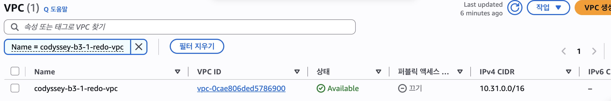 |
| 02 | Public Subnet과 CIDR | 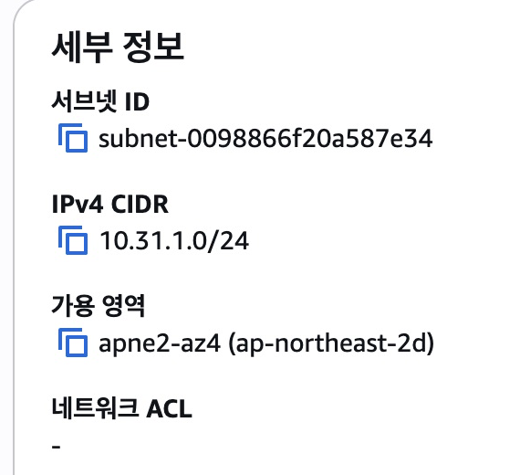 |
| 03 | Internet Gateway 연결 | 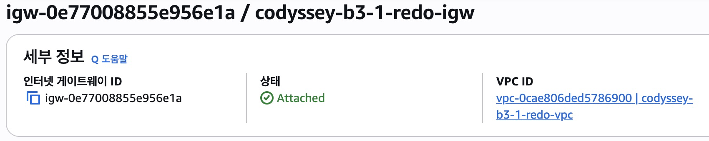 |
| 04 | 서브넷의 인터넷 경로 | 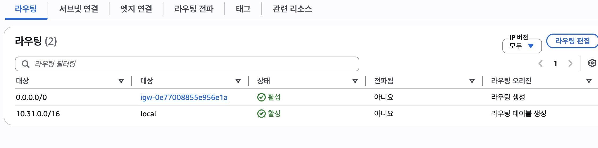 |
| 05 | 실행 중인 EC2와 공인 IP | 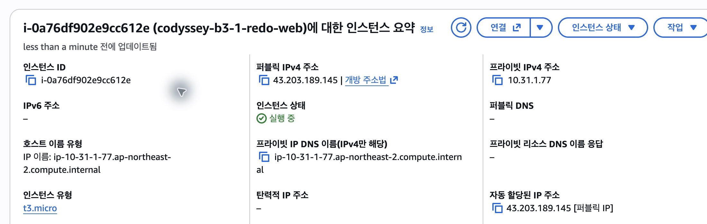 |
| 06 | 외부 Chrome 접속 결과 | 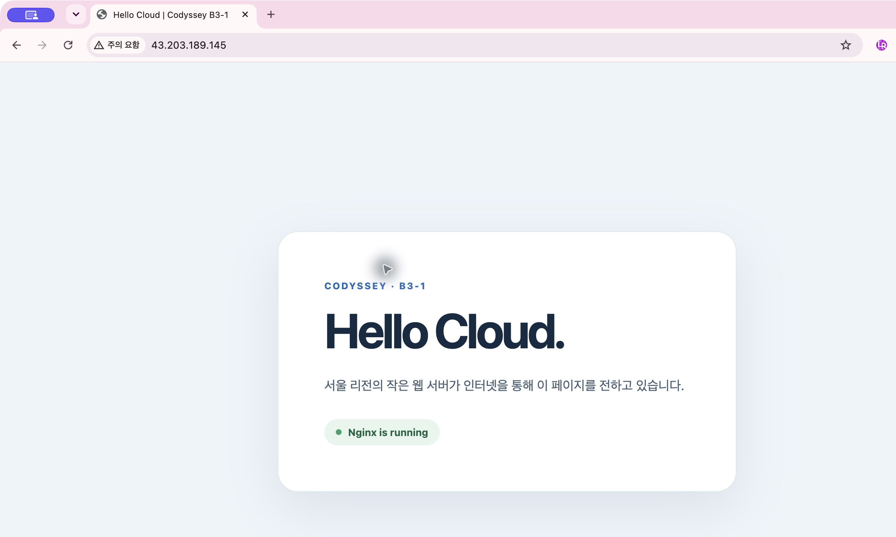 |
| 07 | IAM 콘솔의 규칙 조회 권한 오류 |  |
| 08 | VPC 삭제 후 검색 결과 0건 | 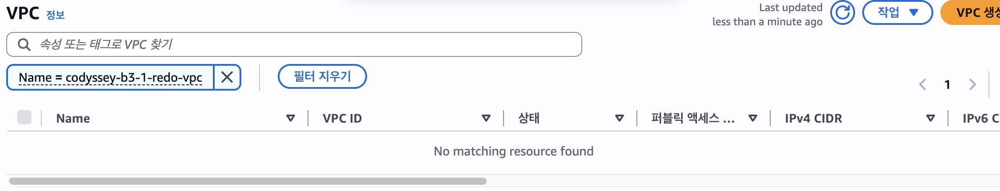 |
| 09 | IAM 정책의 연결 대상 0건 | 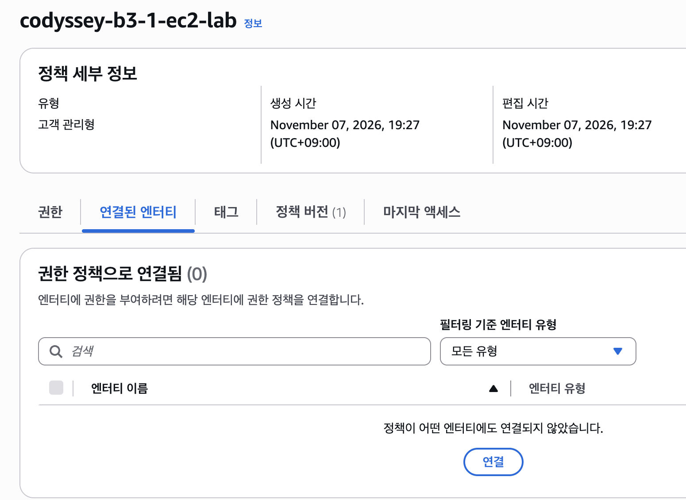 |
| 10 | IAM 사용자 삭제 완료 | 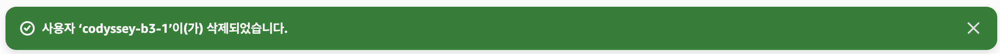 |
| 11 | IAM 정책 삭제 완료 | 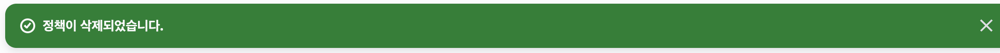 |

## 정리 결과

2026-11-08 00:40 KST에 이번 재실습의 EC2, EBS, 키 페어, 보안 그룹, 라우팅 테이블, Internet Gateway, 서브넷, VPC, 네트워크 인터페이스를 태그 및 ID로 재조회했고 모두 `[]`였다. EC2는 전날 `terminated`를 확인한 후 목록에서도 사라졌다. 별도 Elastic IP는 만들지 않았으며 자동 공인 IPv4는 인스턴스 종료와 함께 해제됐다. [삭제 후 실제 콘솔 화면](docs/screenshots/08-vpc-deleted.png)과 [항목별 체크리스트](docs/cleanup-checklist.md)를 참고한다.

계정 소유자는 루트 콘솔에서 과제용 IAM 사용자 `codyssey-b3-1`과 고객 관리형 정책 `codyssey-b3-1-ec2-lab`을 삭제했다. 제공받은 콘솔 화면에는 정책 연결 대상 0건, 해당 사용자 삭제 완료 알림, 정책 삭제 완료 알림이 각각 표시된다. 삭제 후 과제용 IAM 자격 증명으로 재조회할 수는 없어 이 IAM 삭제 상태의 근거는 **사용자 제공 콘솔 캡처**다. Billing Dashboard의 최종 과금 반영 여부는 확인하지 못했다.
